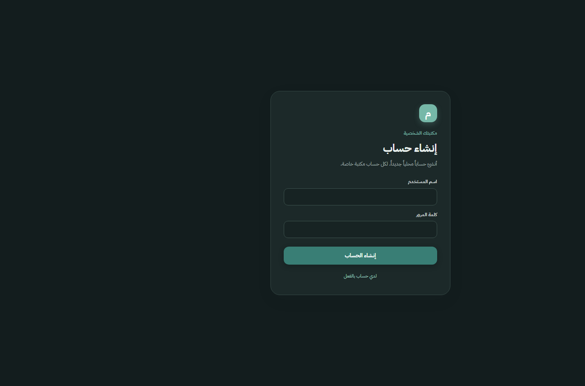
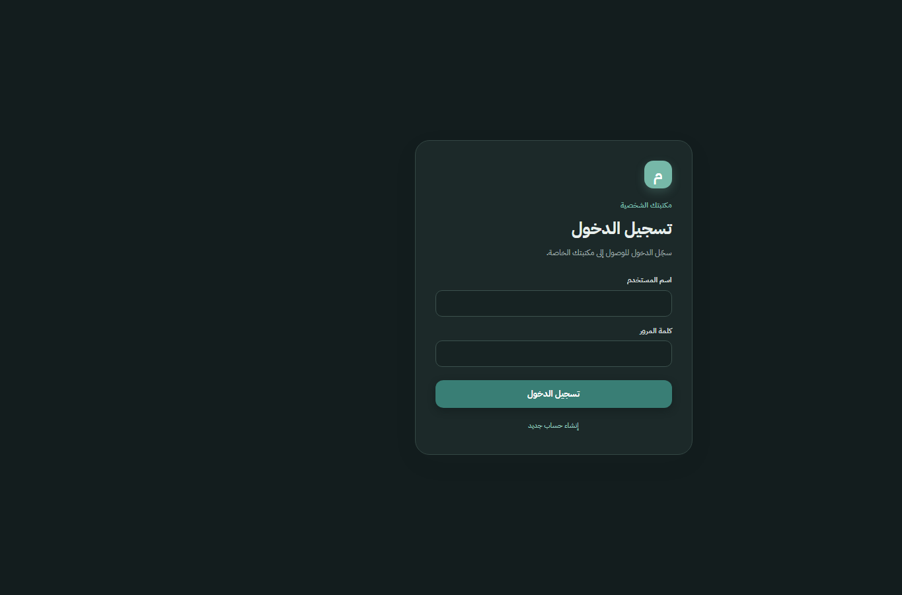
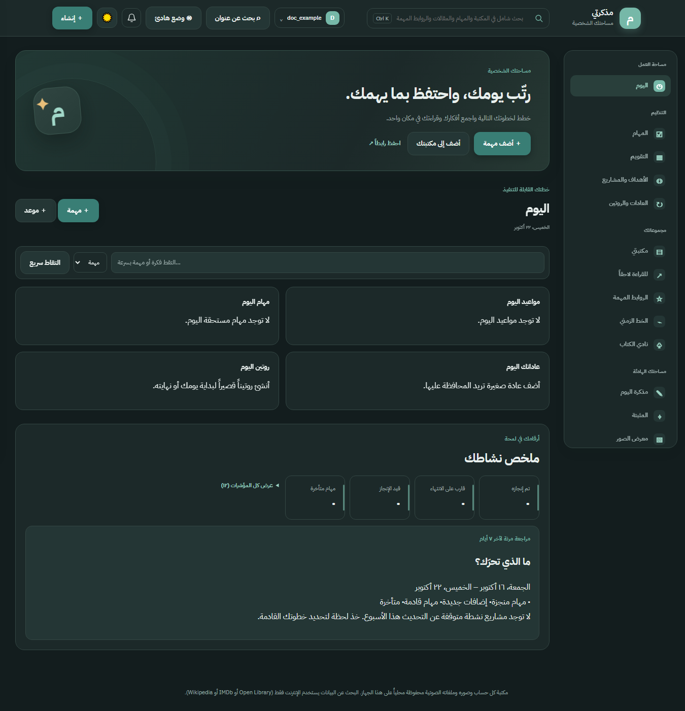
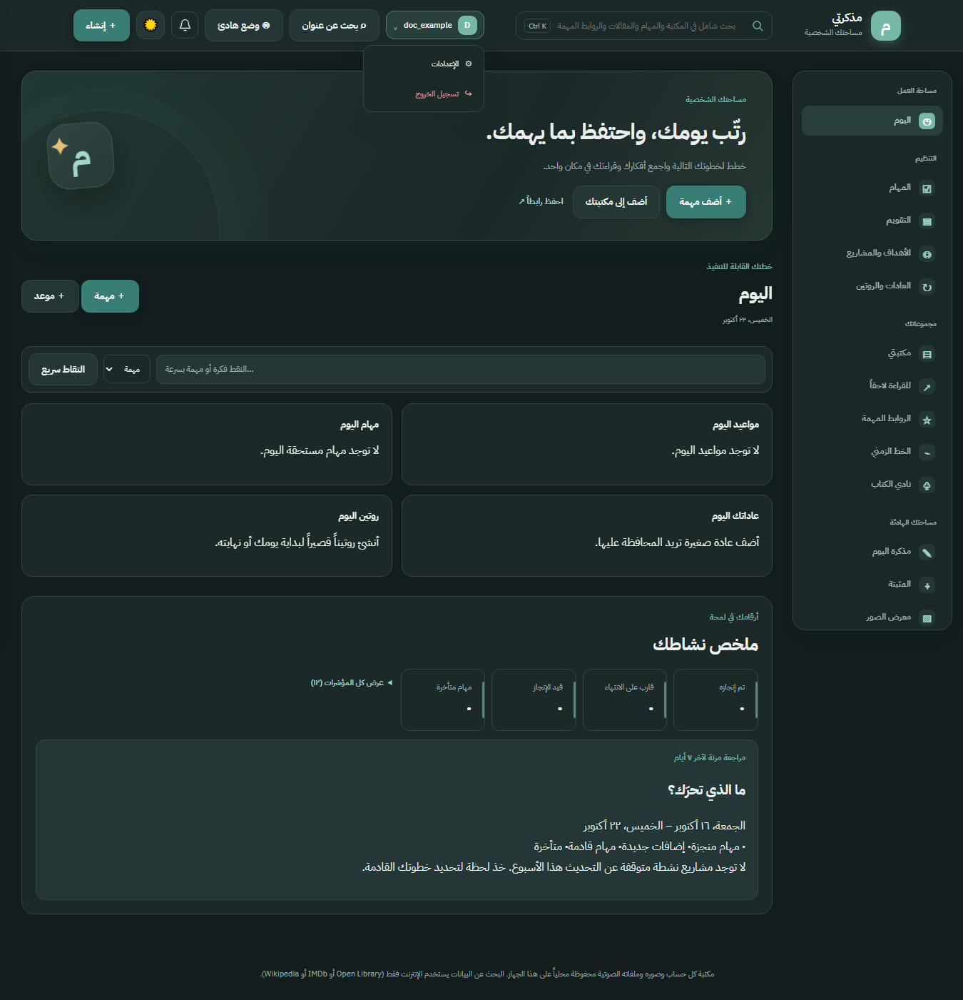

# Authentication

Personal Memo supports multiple local accounts. Each account gets a separate private workspace. The browser signs in with a username and password; the server authenticates subsequent API requests with an HTTP-only session cookie.

## User flows

### First account and registration

When no account exists, the app opens on the **Create account** form. After the first account exists, users can register from the login form using **Create a new account**. Registration signs the new account in immediately.

Usernames are trimmed, converted to lowercase, and must contain 3–32 ASCII letters, digits, or underscores (`a-z`, `0-9`, `_`). Passwords must contain 12–256 characters. Usernames are unique without regard to case. The form uses browser-side constraints as a convenience; the server validates registration independently.

The first account is the application owner. When creating that account, the server also assigns existing unowned library items and matching legacy image files to it. Other accounts do not become owners and have their own private data. Owner-only backup and cloud-storage settings are described in the main [README](../README.md).



### Sign in

After an account exists, the app opens on the **Sign in** form when there is no valid session. Enter the username and password used during registration. Username matching is case-insensitive because input is normalized to lowercase.

Invalid usernames and passwords produce the same response so the endpoint does not reveal whether a username exists. The page displays the server's error message when sign-in fails.



### Signed-in session and sign out

After registration or sign-in succeeds, the app loads the account's workspace. Open the account menu to access **Settings** and **Sign out**. Signing out revokes the current server-side session and clears the browser cookie, returning to the sign-in screen.





The screenshots use an isolated local database and a fictitious demo account; they contain no personal library data.

## HTTP API

All endpoints are mounted below `/api`. Requests that contain a JSON body should use `Content-Type: application/json`. Authentication responses are JSON.

| Method and path | Authentication | Success response | Purpose |
| --- | --- | --- | --- |
| `GET /api/auth/status` | Not required | `200 { "hasUsers": boolean }` | Tells the UI whether to offer first-account creation or sign-in. |
| `GET /api/auth/me` | Required | `200 { "user": { "id": number, "username": string, "isOwner": boolean } }` | Returns the current account's public identity. |
| `POST /api/auth/register` | Not required | `201 { "user": { "id": number, "username": string, "isOwner": boolean } }` | Validates and creates an account, then signs it in. |
| `POST /api/auth/login` | Not required | `200 { "user": { "id": number, "username": string, "isOwner": boolean } }` | Verifies credentials and signs in. |
| `POST /api/auth/logout` | Not required | `200 { "ok": true }` | Revokes the session represented by the request cookie and clears that cookie. |

Example registration request:

```powershell
curl.exe -i -X POST "http://127.0.0.1:4178/api/auth/register" -H "Content-Type: application/json" -d '{"username":"my_account","password":"replace-with-a-long-password"}'
```

Example sign-in request:

```powershell
curl.exe -i -X POST "http://127.0.0.1:4178/api/auth/login" -H "Content-Type: application/json" -d '{"username":"my_account","password":"replace-with-a-long-password"}'
```

For browser clients, allow the browser to store and send the `Set-Cookie` value; do not copy session tokens into application storage or expose them to scripts.

## Validation and errors

| Situation | Status | Response |
| --- | --- | --- |
| Username is empty, too short/long, or contains unsupported characters during registration | `400` | `{"error":"اسم المستخدم يجب أن يكون ٣ إلى ٣٢ حرفاً إنجليزياً أو رقماً أو _."}` |
| Password is shorter than 12 or longer than 256 characters during registration | `400` | `{"error":"كلمة المرور يجب أن تحتوي على ١٢ حرفاً على الأقل."}` |
| Username is already registered | `409` | `{"error":"اسم المستخدم مستخدم بالفعل."}` |
| Username/password do not match, or login password exceeds 256 characters | `401` | `{"error":"اسم المستخدم أو كلمة المرور غير صحيحة."}` |
| A protected endpoint is requested without a valid session | `401` | `{"error":"سجّل الدخول للمتابعة."}` |

The browser performs basic form validation before submission, but API callers must still handle these server responses. A `401` from a protected API request means the user must sign in again.

## Session and data behavior

- Sign-in and registration issue a cryptographically random 32-byte session token. Only its SHA-256 hash is stored in the SQLite `sessions` table.
- The cookie is named `personal_memo_session` and is set for `/` with `HttpOnly`, `SameSite=Strict`, and a 30-day lifetime. It is marked `Secure` when `NODE_ENV=production` or `COOKIE_SECURE=1`.
- Expired sessions are rejected and removed during authentication. A new sign-in replaces the session represented by a valid cookie on that request.
- Sign-out deletes the matching session hash and expires the cookie. Calling sign-out without a valid cookie still clears the browser cookie and returns `{ "ok": true }`.
- Passwords are stored as salted `scrypt` hashes; plaintext passwords are not stored in the database.
- Application data and uploads are stored on the server and are not encrypted at rest. Protect the data directory and backups. For remote access, use HTTPS behind a correctly configured reverse proxy and set `COOKIE_SECURE=1`; see the deployment guidance in the [README](../README.md).

## Related implementation

The route handlers are in [`routes/auth.js`](../routes/auth.js). Cookie creation, token hashing, password hashing, session verification, and mounting the authentication middleware are in [`server.js`](../server.js).
